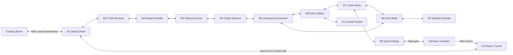

# Eastern island — proposed map

All names, topology, encounters, and rewards below are proposals. This is a
room graph, not a tile-coordinate manifest or a promise of physical adjacency.
The user requires the shore, volcano, and underground maze to be areas with
at least two distinct rooms each, horizontal or vertical placement, and
diversified room sizes. The boss arena is explicitly one single tall room.
The room sizes
below are provisional tile dimensions; jump spacing and edge openings still
need movement measurements during blockout.

## Topology

Mandatory first route: I01 → S02 → I02 → I03 → I04 → I05 → I06 → I07 → I09 → I10.
The alternative I05 → I08 → I07 route rejoins the critical path; neither maze
branch requires an item from the other. I11 is a victory shortcut, never an
entrance that lets the player bypass the boss.

## Areas and room sizes

The shore, volcano, and maze each contain multiple rooms. The boss arena is
the explicit single-room exception. Optional rooms and the return shortcut
do not count toward the minimum of two rooms in the other three areas.
Dimensions are width × height in tiles, not pixels. They propose different
spatial experiences, not fixed final geometry or measured playable jumps.

| Area | Required rooms and proposed dimensions | Arrangement and purpose |
|---|---|---|
| Shore | I01 Island Shore: 96×24; S02 Tidal Terraces: 48×36 | Wide arrival beach followed by a deeper terrace room to its east. |
| Volcano | I02 Basalt Foothills: 64×32; I03 Volcano Ascent: 40×72; I04 Crater Descent: 48×48 | Foothills east of shore; tall ascent above foothills; crater east of ascent, descending toward the maze. |
| Underground maze | I05 Junction: 48×32; I06 Echo Gallery: 80×24; I07 Lower Maze: 72×40; I08 Vent Shaft: 32×64; I09 Quiet Refuge: 32×24 | Junction and gallery form the upper route; lower maze below the gallery; vent shaft west of lower maze closes the loop to the junction. Refuge is the maze's final recovery room. |
| Boss arena | I10 Boss Chamber: 40×80 | One uninterrupted tall room, with vertical ledges and the complete fight inside it. No subdivision into additional boss rooms. |

Additional rooms: I11 Return Tunnel (112×24), O1 Crystal Pocket (24×32),
and O2 Sealed Overlook (40×24). These are supplementary, not substitutes
for the required area rooms. Total proposal: 14 rooms, including 11 required
area rooms, one return room, and two optional rooms.

Horizontal and vertical relationships above describe intended map placement.
Choose exact coordinates and matching edge spans together during blockout;
different room heights do not imply that their floors automatically align.
Check the whole maze loop for a feasible, nonoverlapping physical embedding.
The long return connection needs an explicit placement/door decision; the
graph does not imply that one straight room can cross occupied map space.

## Room beats

Intensity is a design target from 0 (rest) to 1 (climax), not runtime data.

| ID | Room purpose | Proposed play | Intensity |
|---|---|---|---|
| I01 | Island Shore | Safe arrival, visible volcano, raft return, regeneration space. | 0.1 |
| S02 | Tidal Terraces | Explore the coastal area through stepped rock shelves; dry mandatory route and a clear view inland. | 0.3 |
| I02 | Basalt Foothills | Short ordinary jumps; preview the volcanic terrain safely. | 0.3 |
| I03 | Volcano Ascent | Alternating ledges and safe shelves; readable climb toward crater. | 0.6 |
| I04 | Crater Descent | Reveal the underground route; every drop has a jump-only way back. | 0.3 |
| I05 | Underground Junction | Central landmark: bright split rock with two distinct exits. | 0.2 |
| I06 | Echo Gallery | Upper maze route, occasional enemies, crystal landmark. | 0.5 |
| I07 | Lower Maze | Routes converge at a recognizable root/rock arch; reveal refuge. | 0.6 |
| I08 | Vent Shaft | Alternate vertical route; safe shelves; loop back to junction. | 0.5 |
| I09 | Quiet Refuge | Safe energy recovery and room spawn before boss; no new bench system. | 0.1 |
| I10 | Boss Chamber | Test jump timing, positioning, and environmental attack baiting. | 1.0 |
| I11 | Return Tunnel | Low-pressure reward route; open persistent shortcut to shore. | 0.1 |
| O1 | Crystal Pocket | Short dead end with optional collectible and clear return. | 0.3 |
| O2 | Sealed Overlook | Optional view back to the island; collectible, no required progression. | 0.2 |

Use proposed IDs as labels until room naming conventions are selected. Reserve
an eastern area in the world grid only after checking existing room extents;
do not infer free space from room origins alone.

## Maze readability

- Give I05, I06, and I07 different silhouettes as well as color cues.
- Show exits within camera view before asking the player to choose.
- Keep optional dead ends short and reward them; avoid long empty wrong turns.
- Let the loop provide a second route, rather than making identical corridors.
- Place a recognizable landmark on both sides of each inter-room connection.
- Darkness and decorative tunnels must not hide collision boundaries.

## Boss proposal: volcanic guardian

Placeholder identity; not the existing Ape and not an approved final design.

The guardian telegraphs a ground strike aimed at the player's position. The
player baits it onto a visible weak floor plug, then jumps to a safe ledge.
A successful strike breaks the plug and vents pressure into the guardian.
Three successful baits are a proposed starting point for tuning.

1. First plug: generous telegraph, nearby safe ledge, one attack at a time.
2. Second plug: different position; require crossing the arena between attacks.
3. Third plug: combine familiar movement with a shorter recovery, retaining
   a safe route and a clearly visible wind-up.

The guardian's body must not block access to all safe ledges. Broken plugs
must never remove the last traversable floor or turn retry spawns lethal.
Use the arena's height for reachable ledge tiers and movement between attack
cycles, with safe routes up and down. Keep the entire encounter in I10;
camera tracking must reveal telegraphs and landing targets without requiring
offscreen jumps. The floor-plug concept is provisional and must be reviewed
for compatibility with this tall arena rather than implying a wide flat fight.
No sword, dash, wall grab, or mandatory damage is required. Avoid adding
continuous energy drain: repeated jumps already spend energy.

On defeat, keep the boss beaten, release fight gates, and expose I11. Reward
selection remains open. Reuse existing persistence conventions if possible;
new floor-plug, boss, and shortcut state are implementation dependencies.

## Geometry and retry constraints

- Measure jump height, elevated-landing reach, collider clearance, and energy
  recovery using default tuning at the project's 60 Hz physics timestep.
- Keep required jumps comfortably within measured reach; reserve tight jumps
  for optional collectibles. Do not use ideal ballistic formulas as proof.
- Provide safe standing shelves between mandatory jump sequences so the route
  works from minimum arrival capacity without optional energy pickups.
- Avoid forced underwater travel and new lava damage rules in the first blockout.
  Existing hazards can stand in until volcanic mechanics are approved.
- Boss entry must reliably establish a safe retry spawn using existing room
  behavior. Verify whether I09 or I10 should own it before implementation.
- Death during the fight resets temporary arena changes. Victory persists;
  returning to the island must not relock the shortcut or retrigger the fight.
- A test-only entrance may bypass the unimplemented raft for development; it
  must not silently become the story's player-facing travel mechanism.
