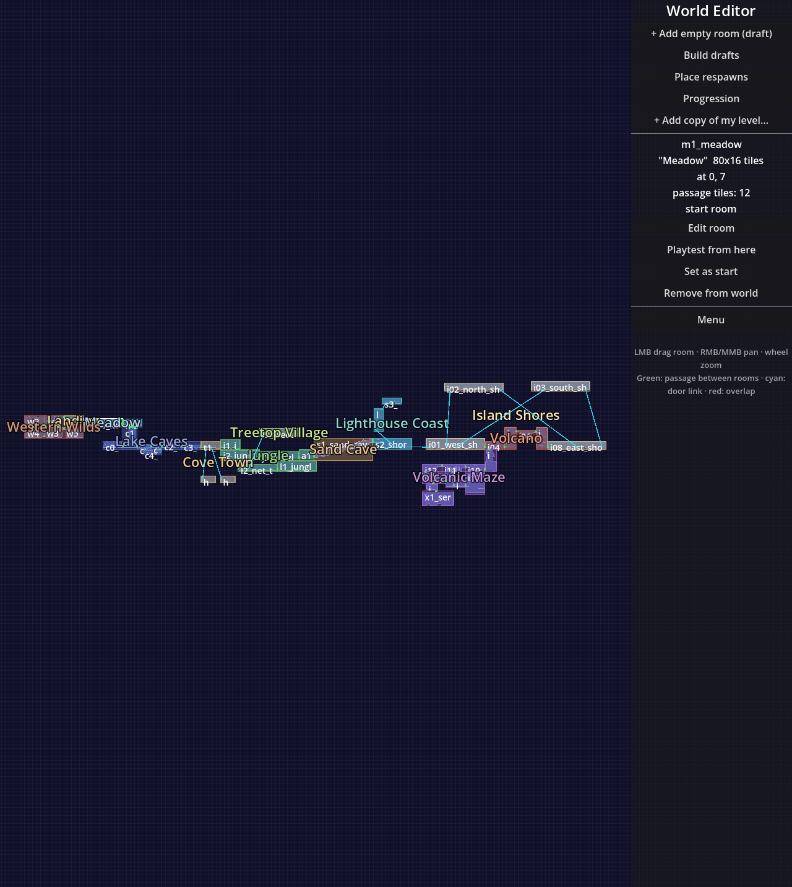

# Progression review — 2026-10-30

Fixed unavailable-filter removal of reachable Ape/Guardian steps, inconsistent
filtered-map summaries, ignored starting abilities, malformed URL hash failures,
and HTML injection through room titles. Added route-preserving navigation and
two-click selection of previous steps, independent tabs, compact help, and a
larger map pane.

The World Editor now launches snapshot analysis without blocking gameplay UI,
reports failures, and opens/reopens the browser viewer. Source desktop builds
require Python 3; HTML is viewed externally rather than embedded.

Validation: 15 layout/model tests, 2 worker tests, a Godot editor test including a
real child process, editor scroll and smoke scenes, and Chromium desktop/mobile
interaction assertions. Visual checks cover the viewer and editor launcher.

The reachability model remains an approximation of player movement. The unused
legacy metro renderer is cleanup debt; it was left outside these behavior fixes.
